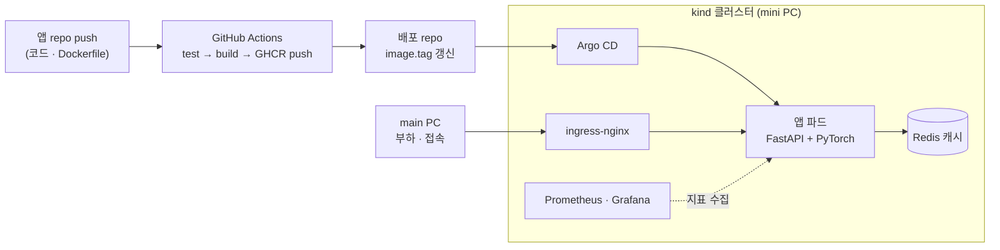

# k8s-gitops-kind

PyTorch 추론 서버(FastAPI)를 Kubernetes(kind: Kubernetes IN Docker)에서 운영하며 **배포, 장애 대응, 확장, 보안**을 직접 검증한 기록이다. 코드를 push하면 CI가 테스트·빌드하고 Argo CD가 배포하는 GitOps 흐름 위에서, 장애를 일부러 일으키고 원인을 진단해 판단 근거를 남겼다. 결과도 중요하지만, 실험마다 시나리오와 판단 기준을 먼저 세우고 어떻게 검증할지에 집중했다.

## 표기

사례 표의 숫자와 코드는 다음 뜻이다. HTTP 응답 코드: `200` 정상 응답, `403` 권한 없음, `500` 서버 오류, `503` 서비스 불가, `000` 응답 없이 연결이 끊김(부하 도구의 표기). 컨테이너 종료 코드: `0` 정상 종료, `137` SIGKILL로 강제 종료. `p50`은 응답 시간의 중앙값, `p95`는 느린 쪽 5%가 시작되는 값이다.

## 아키텍처

## 환경

모든 사례가 공유하는 환경이다. 사례 페이지에는 반복하지 않고 해석에 필요한 조건만 쓴다.

| 구분 | 내용 |
|---|---|
| 하드웨어 | mini PC (Ubuntu 24.04.5 LTS, 4코어, RAM 16GB, GPU 없음). 개발과 모든 실험을 mini PC에서 진행 |
| 작업 방식 | Windows main PC에서 SSH로 mini PC에 접속해 작업 |
| 클러스터 | kind(Kubernetes IN Docker), Kubernetes v1.30 (control-plane 1 + worker 2) |
| 인그레스 | ingress-nginx v1.11.2 |
| CI | GitHub Actions, 이미지 저장소 GHCR |
| GitOps | Argo CD v3.5.7 (Helm chart로 설치), 앱 repo와 배포 repo 분리 |
| 패키징 | Helm v4.3.1, chart 구성·검증 |
| 관측 | kube-prometheus-stack(Prometheus, Grafana), 대시보드 9개 패널 |
| 앱 | FastAPI + PyTorch(ResNet50) 이미지 분류 추론 서버, Redis 결과 캐시. 컨테이너 이미지 1.24GB(multi-stage, non-root) |
| 부하 발생 | 같은 LAN의 main PC에서 부하 스크립트 실행 |

## 사례

| 사례 | 한 줄 결론 |
|---|---|
| [01. GitOps 파이프라인의 안전장치](cases/01-gitops-pipeline.md) | 테스트가 깨진 커밋은 배포되지 않지만, 잘못된 배포 태그는 아무도 되돌리지 않는다 |
| [02. HPA 오토스케일링](cases/02-autoscaling.md) | 21초 만에 2 → 4개로 늘려 평균 응답을 약 40% 줄였지만 꼬리 지연은 남았다 |
| [03. 무중단 배포와 graceful shutdown](cases/03-graceful-shutdown.md) | 롤링 재시작의 5초 지연은 종료 중인 파드로 간 요청이었고 `preStop`으로 없앴다 |
| [04. 장애 시나리오 11개 재현](cases/04-failure-series.md) | 종료 코드와 이벤트 문구로 원인을 갈라 내는 순서를 정리했다 |
| [05. 노드 drain과 PDB](cases/05-node-drain.md) | 파드가 한 노드에 몰려 있으면 서비스가 끊기고, 엄격한 PDB는 작업을 멈춘다 |
| [06. 보안 기본기](cases/06-security.md) | 권한은 준 것만, Pod Security는 경고 후 강제, 이미지 스캔은 고칠 수 있는 것만 게이트로 |
| [07. 스케줄링과 스토리지](cases/07-scheduling-storage.md) | Pending 원인은 이벤트 한 줄로 갈리고, 상태 저장 파드의 위치는 볼륨이 정한다 |
| [08. 캐시 장애 대응](cases/08-cache-degradation.md) | Redis가 죽어도 API는 계속 응답한다 |
| [09. probe와 종료 신호](cases/09-probes-and-sigterm.md) | readiness는 트래픽에서 빼고 liveness는 재시작하며, SIGTERM이 앱에 닿지 않으면 종료에 30초가 걸린다 |
| [10. 그 밖에 확인한 것](cases/10-more-checks.md) | 리소스 쿼터, DaemonSet, Job, StatefulSet, Helm, Argo CD, 관측 구성 등 직접 확인한 것을 한 줄씩 |

## 범위와 한계

- 단일 mini PC 위의 kind에서 검증한 결과이고, 운영 규모의 경험이 아니다. 측정 시간 및 수치는 1회성 확인으로 나온 값으로 통계 값은 아니다.
- 하지 않은 것:
  - 네트워크 정책(NetworkPolicy)
  - 알림(Grafana Alerting): 알림 규칙과 전달 채널은 구성하지 않았다.
  - 로그 수집: 노드마다 수집기(Fluent Bit 등)를 DaemonSet으로 띄우는 방식은 DaemonSet 실습과 겹치고, 수집한 로그를 저장하고 보여 줄 별도 시스템이 필요해서 하지 않았다.
  - 노드 추가·제거: kind는 설정 파일로 노드 구성을 정해 클러스터를 만드는 방식이라 실습하지 않았다. EKS에서 다룬다.
  - AWS 환경: EKS 프로젝트에서 다룬다.
- **다음 프로젝트:** kind에서 검증한 구조를 EKS(Terraform)로 옮기는 `eks-terraform`을 별도로 진행할 계획이다. 사례별로 이어서 확인할 것은 다음과 같다(아직 하지 않은 계획).
  - GitOps([01](cases/01-gitops-pipeline.md)): webhook으로 감지 지연 줄이기, GitHub OIDC로 쓰기 자격증명 없애기, Argo CD Notifications로 알림
  - 확장과 스케줄링([02](cases/02-autoscaling.md), [04](cases/04-failure-series.md), [07](cases/07-scheduling-storage.md)): Pending 파드를 노드 증설로 잇는 Cluster Autoscaler/Karpenter, AZ별 노드 그룹이 필요한 이유, 볼륨의 AZ 바인딩 이벤트 문구
  - 종료 처리([03](cases/03-graceful-shutdown.md)): 로드밸런서의 등록 해제 대기 시간과 대상 제거 시차, 노드 종료 시의 grace 처리
  - 노드 점검([05](cases/05-node-drain.md)): 관리형 노드 그룹 업데이트와 Karpenter의 노드 정리가 PDB 때문에 멈추는 동작
  - 보안([06](cases/06-security.md)): IAM → RBAC 접근 경로, IRSA, ECR 이미지 스캔과 Trivy 결과 비교
  - 캐시([08](cases/08-cache-degradation.md)): 관리형 캐시(ElastiCache)의 장애 형태(타임아웃과 거부)와 failover 시간
