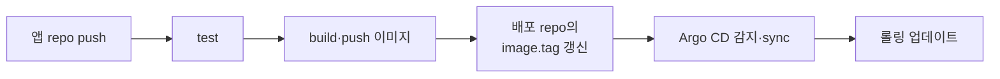
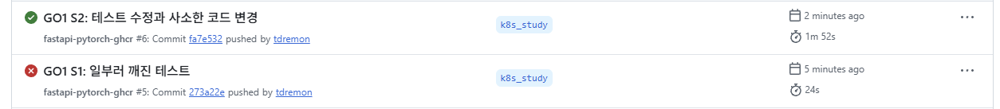

# 테스트가 깨진 커밋은 배포되지 않지만, 잘못된 배포 태그는 아무도 되돌리지 않는다

> CI → Argo CD 배포 파이프라인이 어디까지 스스로 막아 주는지 일부러 장애를 내서 확인했다. 결과: 코드 오류는 CI가 막고, 서비스 중단은 Kubernetes가 막지만, **배포 repo에 들어간 잘못된 값은 사람이 되돌려야 한다.**

**조건** 앱 파드 2개(롤링 `maxUnavailable: 1`) · 부하는 처음부터 끝까지 0.5초 간격으로 계속 발생 · 공통 [환경](../README.md#환경)



## 실험과 결과

| # | 조작 | 결과 |
|---|---|---|
| 1 | 테스트를 일부러 깨뜨려 push | **24초 만에 CI 실패.** 배포 repo 새 커밋 0개, 파드 변화 0건 |
| 2 | 테스트를 고쳐 push | 사람 개입 없이 **push 후 4분 17초에 새 이미지로 배포 완료**(Actions 1분 52초 → Argo CD 감지 2분 3초 → 롤링 22초). 롤링 중 실패 요청 0건 |
| 3 | 배포 repo에 없는 이미지 태그를 직접 커밋 | CI를 거치지 않아 Argo CD가 그대로 반영. 새 파드는 `ImagePullBackOff`, 기존 파드 1개가 서비스를 유지해 **요청 3,602건 전부 정상 응답(`200`)**. 단 용량은 절반. Argo CD는 정확히 10분 뒤 `Degraded`로 표시만 하고 되돌리지 않음 |
| 4 | 그 커밋을 `git revert` | **2분 8초 만에 `Healthy` 복구** |



## 내가 내린 판단

| 안전장치 | 막아 주는 것 | 못 막는 것 |
|---|---|---|
| CI (테스트 게이트) | 깨진 코드의 빌드·배포 | 배포 repo에 사람이 직접 커밋한 값 |
| Kubernetes (롤링 설정, probe) | 서비스 중단 | **용량 절반** (`maxUnavailable: 1`이라 기존 파드 1개가 먼저 내려감) |
| Argo CD | 상태 감지와 표시 | 자동 롤백 (`Degraded` 표시까지 10분이 걸려 알림이 없으면 놓침) |
| 사람 | `git revert`로 복구 | — |

- 배포 repo는 **커밋하는 사람이 곧 배포 결정자**다. 보완책은 배포 repo의 PR 리뷰와 브랜치 보호이며, 이번에는 적용하지 않았다.
- 용량을 지키려면 `maxUnavailable: 0`과 여유 자원이 필요하고, 운영에서는 `Degraded` 알림이 필요하다.

**한계** 감지 지연(약 2분)은 Argo CD 기본 polling 주기(3분) 안의 값이고, "스스로 되돌리지 않음"은 관찰한 약 14분 동안만 확인했다.

<details>
<summary>더 보기: 실험 3의 타임라인 (로그 발췌, 시각은 상대값으로 변환)</summary>

```
+00:00  pytorch-infer-…  0/1  ContainerCreating  # 새 파드 생성(기준 시점)
+00:01  sync=Synced health=Progressing          # 없는 태그가 반영됨
+06:20  pytorch-infer-…  0/1  ImagePullBackOff  # 새 파드는 계속 실패
+10:01  sync=Synced health=Degraded             # Progressing 후 정확히 10분, 되돌림 없음
```

이 구간 동안 Ready 파드는 1개(endpoints 1개)였고 요청은 모두 `200`이었다. 정상 배포에서도 새 파드 모델 로딩(약 20초) 동안 같은 상태가 잠깐 생긴다. 실험 3은 그 상태가 **끝나지 않고 14분 계속된 것**이다.

</details>
