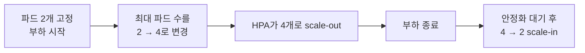
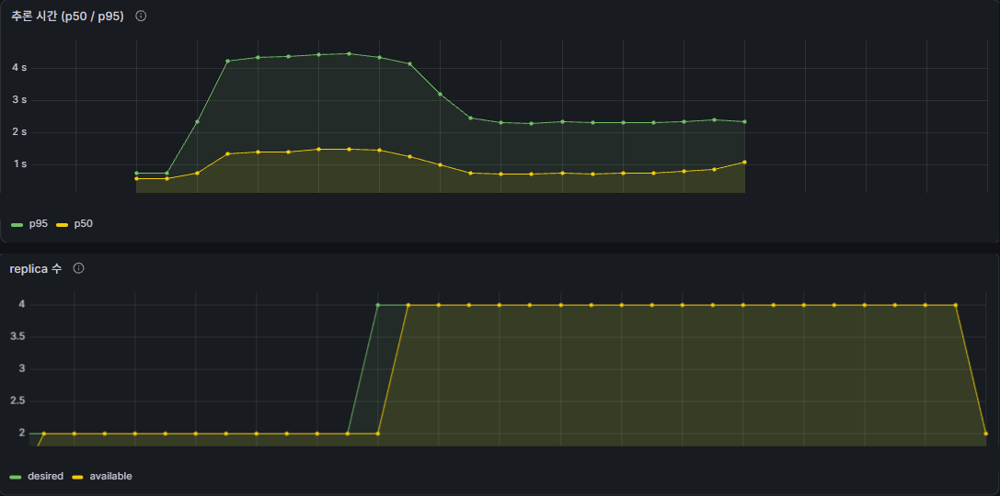

# HPA는 21초 만에 파드를 2개에서 4개로 늘려 평균 응답을 약 40% 줄였지만 p95는 여전히 느렸다

> **같은 부하에서 파드 2개 고정과 HPA scale-out을 비교**하고, 부하가 사라진 뒤 스스로 줄어드는 시점까지 확인했다. 평균은 확실히 좋아졌지만 p95는 p50의 2.9배로 여전히 넓었다.

**조건** 앱 파드 CPU requests = limits = `500m` · `TORCH_NUM_THREADS=1` · HPA CPU 목표 50% · 응답 목표: p95 ≤ p50의 2배 · 캐시 끔 · 동시 요청 4개로 약 7분 · 공통 [환경](../README.md#환경)

**용어** **응답 시간**은 부하 도구가 잰 요청 하나의 왕복 시간이다(캐시를 껐으므로 PyTorch 모델 추론 1회가 들어 있다). **p50**은 중앙값, **p95**는 느린 쪽 5%가 시작되는 값이다.

## 실험과 결과

| # | 조작 | 결과 |
|---|---|---|
| 1 | 파드 2개 고정, 동시 요청 4개 | 평균 응답 **1.59초**, p95 3.37초 |
| 2 | 최대 파드 수를 2 → 4로 변경 | HPA가 0.7초 만에 4개로 결정, **21초 만에** 4개 모두 Ready (이미지 로딩 + 기동 대기 10초 + readiness) |
| 3 | scale-out 후 같은 부하 | 평균 **0.95초(약 0.6배)**, p95 2.06초, 부하 전체(1,421건) 모두 `200`. 단 p95가 p50의 2.9배(목표였던 2배 이하에는 미달) |
| 4 | 부하 종료 | CPU 0%인데 **5분 22초 동안 4개 유지**, 그 뒤 2개로 scale-in |

## 내가 내린 판단

- **HPA는 빠르게 늘리고 느리게 줄인다.** scale-out은 0.7초에 결정했지만 Ready까지는 21초가 걸렸고, scale-in은 HPA의 기본 안정화 대기 300초(5분) 때문에 부하가 사라져도 그만큼 미뤄졌다. "부하가 0인데 파드가 안 준다"를 장애로 보지 않는다.
- **requests = limit이면 사용률이 100%에 붙는다.** 목표 50%로 수렴하는 것이 아니라 상한까지 한 번에 점프했다(2 → 4). 그래서 `maxReplicas`가 곧 설계 값이 되고, 최대 파드 수 × limit(4 × 500m = 2코어)이 4코어 머신에 맞는지로 정했다.
- **파드를 늘려도 분산은 고르지 않다.** 인그레스가 요청 단위로 라운드로빈해서 파드당 동시 요청이 0~2개로 흔들렸다. 지연 목표가 있다면 평균이 아니라 p95로 판단해야 한다.

**한계** scale-in 중 요청 에러는 이 실행으로 판단할 수 없다. 두 번째 부하 명령이 의도대로 동작하지 않아 부하 없이 줄어드는 것만 확인했다. 부하는 응답을 받아야 다음 요청을 보내는 계단형 하나뿐이고 점진적 증가나 급증은 보지 않았다.

더 보기: 구간별 응답 시간 (로그 집계)

| 구간 | 요청 수 | 평균 | p50 | p95 | 최대 |
|---|---|---|---|---|---|
| 파드 2개 고정 | 352 | 1.590초 | 1.287초 | 3.368초 | 4.03초 |
| 4개로 scale-out한 뒤 안정 구간 | 753 | 0.947초 | 0.715초 | 2.063초 | 2.92초 |

고정 구간의 평균은 scale-out 후의 1.68배다. 두 구간은 연속 실행이지만 완전히 같은 조건은 아니다(CPU 클럭과 온도).

