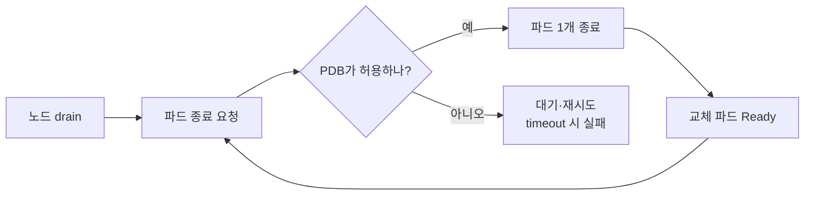

# 노드를 비울 때 파드가 한 노드에 몰려 있으면 서비스가 끊기고, 너무 엄격한 PDB는 작업을 멈춘다

> 노드 점검(drain, 노드의 파드를 다른 노드로 옮기며 비우는 작업)을 PDB(PodDisruptionBudget, 동시에 내려갈 수 있는 파드 수의 제한) 없이, PDB `maxUnavailable: 0`, PDB `maxUnavailable: 1` 세 가지로 비교했다. "에러가 없다"가 안전하다는 뜻은 아니었고, **PDB는 파드가 분산 배치되어 있을 때 제 효과**를 낸다.

**조건** 앱 파드 5개(`preStop: sleep 5`, 기동 대기 10초), 부하는 추론 없는 `/info`를 0.5초 간격으로 인그레스 경유 · 공통 [환경](../README.md#환경)

## 실험과 결과

| # | 조작 | 결과 |
|---|---|---|
| 1 | PDB 없이 파드 3개가 있는 노드를 drain | 3개가 동시에 종료되어 Ready가 5 → **2**로 떨어졌다가 약 16초 뒤 복귀. 부하 20건은 전부 `200` |
| 2 | PDB 없이 5개가 한 노드에 몰린 노드를 drain | 5개 동시 종료로 endpoint가 15.9초 동안 비어 **503(서비스 불가)이 25건**(12초). 앞 약 4초는 종료 중인 파드가 `preStop` 동안 아직 응답했다 |
| 3 | PDB `maxUnavailable: 0`으로 drain | 앱 파드를 하나도 못 내리고 `Cannot evict`를 60초 동안 **60번 반복하다 실패.** 서비스는 무사(부하 117건 전부 `200`) |
| 4 | PDB `maxUnavailable: 1`로 완화 | 약 15초 간격으로 하나씩 이동, Ready가 4 아래로 안 내려가고 에러 0. 5개를 옮기는 데 **약 75초**라 60초 timeout에서는 마지막 1개를 못 옮기고 실패 |

## 내가 내린 판단

- **PDB는 분산 배치(topology spread)와 함께 써야 한다.** 실험 1은 전부 `200`이었지만 용량이 5에서 2까지 떨어졌고, 에러는 파드가 전부 한 노드에 있을 때만 드러났다. PDB는 동시 종료 수를 제한할 뿐이고, 이번에도 drain만으로 5개가 한 노드에 몰렸다.
- **drain 시간은 `파드 수 × 교체 파드 준비 시간`이다.** 교체 파드가 Ready가 되기까지 약 15초라 PDB `maxUnavailable: 1`에서는 5개에 약 75초가 걸린다. 노드 업데이트 자동화의 timeout은 이 값보다 길어야 한다. 짧으면 이번처럼 중간에 실패하고 노드는 스케줄 불가 상태로 남는다.
- **PDB `maxUnavailable: 0`은 서비스를 지키는 대신 작업을 멈춘다.** HPA로 replicas가 바뀌어도 의미가 유지되는 PDB `maxUnavailable: 1`을 쓰고 0은 쓰지 않는다. 노드 업그레이드가 멈췄다면 `get pdb`의 허용 중단 수와 `Cannot evict` 메시지를 확인한다.

**한계** 부하가 추론 없는 `/info`라서 실험 1의 용량 저하는 에러로 나타나지 않았다. timeout을 300초로 늘려 재실행해 정상 종료를 확인하지는 않았다. 노드가 갑자기 죽는 경우나 `delete pod`, 롤링 업데이트는 PDB가 막지 못하는데 이 실험에서는 다루지 않았다.

더 보기: drain의 부작용

- drain마다 5개 파드가 한 노드로 몰렸고, 다시 분산하려면 `rollout restart`가 필요했다.
- 모니터링 구성 요소와 **Redis(1개, PDB 없음)** 도 함께 내려갔다. 파드가 하나뿐인 구성 요소는 drain 때마다 잠깐 끊긴다.
- 에러 집계: 전체 871건 중 200이 아닌 요청은 실험 2의 503 25건뿐이었다. 부하 도구가 503의 HTML 본문을 여러 줄로 출력해 상태 코드 열이 깨져서, 503은 레코드 단위로 파싱해 집계했다.

