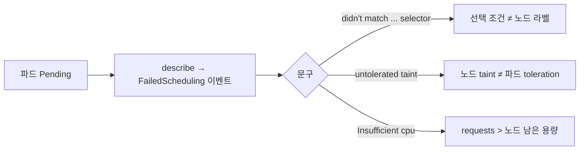

# Pending 원인은 이벤트 한 줄로 갈리고, 상태 저장 파드의 위치는 볼륨이 정한다

> 스케줄링 세 가지를 확인했다. ① 파드가 `Pending`인 원인 진단 ② replica 분산 규칙의 차이 ③ 볼륨을 가진 파드가 노드에 묶이는 것. 셋 다 EKS에서 노드 증설과 AZ 설계를 할 때 다시 확인할 부분이다.

**조건** 가벼운 테스트 파드(`pause` 이미지)로 배치만 확인, 앱은 건드리지 않음. 두 워커 노드를 서로 다른 zone으로 라벨링 · 공통 [환경](../README.md#환경)

## 실험과 결과

| # | 조작 | 결과 |
|---|---|---|
| 1 | Pending 원인 3가지를 하나씩 만들고 해소 | 원인마다 `FailedScheduling` 문구가 다르다(위 그림). 원인을 해소하면 **1.1초 이내**에 Running. 노드를 고치면 같은 파드가, 파드를 고치면 새 파드가 뜬다 |
| 2 | replica 4개를 `required` anti-affinity vs topology spread(`DoNotSchedule`)로 분산 | anti-affinity는 노드 수가 상한이라 2개가 Pending, topology spread는 4개 모두 Running(노드마다 2개) |
| 3 | zone 하나를 cordon하고 6개 요구 | `DoNotSchedule`은 1개를 Pending으로 둠. `ScheduleAnyway`는 6개를 전부 띄우되 한 노드에 몰렸고 cordon을 풀어도 **스스로 재분산되지 않음**(재시작하자 노드마다 3개) |
| 4 | 볼륨(PVC)을 가진 파드를 삭제·재생성 | 데이터는 남지만 **볼륨이 있는 노드에서만** 다시 뜬다. 그 노드를 cordon하자 다른 워커가 비어 있어도 37초간 Pending, 복구하자 0.02초 만에 같은 노드에 배치 |

## 내가 내린 판단

- **진단은 `FailedScheduling` 한 줄로 끝난다.** 모든 이벤트 맨 앞의 control-plane taint 구절은 배경이라 건너뛰고, 워커에 붙은 사유를 읽는다. 스케줄러는 실제 사용량이 아니라 requests로 판단하므로, 아무 일도 안 하는 파드도 100코어를 요청하면 거절된다.
- **`NoSchedule` taint는 이미 떠 있는 파드를 내쫓지 않아 장애가 늦게 드러난다.** taint를 건 뒤에도 파드는 81초간 정상이었고, 재생성할 때 비로소 Pending이 됐다. 변경 직후 재시작해서 확인해야 한다.
- **`ScheduleAnyway`는 가용성을 얻고 균형을 잃는다.** 장애 중에는 파드가 전부 살아남지만 한 노드에 몰리고, 복구해도 스케줄러는 이미 뜬 파드를 옮기지 않는다. 균형이 중요하면 `DoNotSchedule`을 쓰고 Pending을 감수하거나, 재시작·디스케줄러로 되돌린다.
- **상태를 가진 파드의 위치는 스케줄러가 아니라 볼륨이 정한다.** EKS에서는 EBS 볼륨이 AZ에 묶이므로 같은 문제가 생길 것으로 본다. 상태 저장 워크로드는 노드(AZ) 하나의 장애가 곧 파드의 장애라는 전제로 설계한다. Pending 이벤트만으로는 볼륨이 원인인지 보이지 않아 `describe pv`의 노드 조건부터 확인한다.

**한계** 이 클러스터는 zone 하나에 노드가 하나뿐이라 노드 기준 분산과 zone 기준 분산의 차이는 구분하지 못했다. cordon은 노드 장애의 근사일 뿐 실제 노드 다운과 다르다. 볼륨 때문이라는 사유가 이벤트에 직접 찍히지는 않았다.
